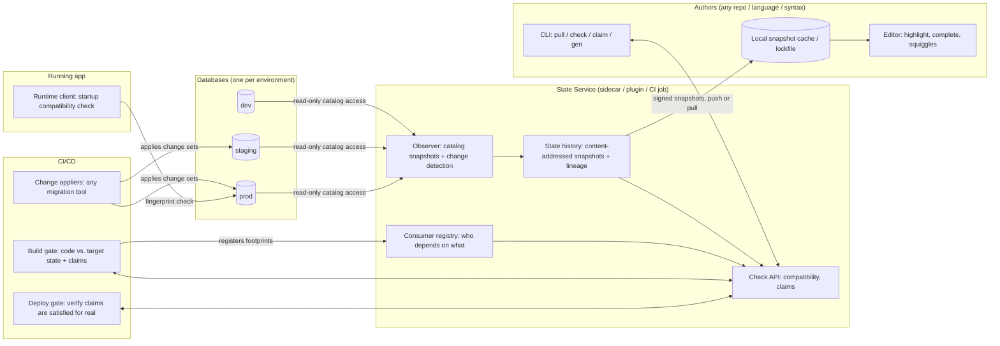

# 02 — Concept Overview

## 1. One-sentence version

**`dst` publishes a database's live, versioned structural state as a contract, and checks all code that changes or queries that database against the contract, in the editor, in CI, at deploy time and at app startup, whatever syntax the code is written in and wherever the change comes from.**

## 2. The big picture

## 3. Core ideas

### 3.1 The database's own state is the source of truth, not files

Migration files, Prisma schemas, Drizzle tables and DBA scripts are all **ways to change state**. None of them is the state. The only authoritative answer to "what does prod look like?" is prod's catalog. `dst` reads it (with a read-only, data-blind role), normalizes it, and publishes it.

This one move handles requirement R6 (schema owned elsewhere): `dst` doesn't care who changed the database or how.

### 3.2 State is versioned and content-addressed

Each observed state is serialized canonically and hashed, giving a **state fingerprint**. The history of fingerprints per environment forms a **lineage**. Environments are like git refs pointing at a state (`prod → 9f3a…`, `staging → c21e…`). See [05](05-state-model-and-versioning.md).

### 3.3 Code declares what it needs, as a footprint

Every query or schema reference in application code is analyzed into a **footprint**: the set of database objects and shapes it relies on ("table `public.users` has column `email` of type `text`", "function `get_post_count(uuid)` returns `int4`"). The footprint, not the whole schema, is what gets checked against a target state. Unrelated schema changes don't invalidate code. See [06](06-claims-and-build-gates.md).

### 3.4 Unmet requirements need an authority, a claim

If code's footprint isn't satisfied by the target environment's current state, the build fails **unless** the author attaches a **claim** saying a particular change will be applied before this code runs. A claim can point to:

- a change set **in the same PR** (verified right away by applying it to a copy of the target state),
- a change in **another repo / pipeline / tool** (referenced by ID or by expected resulting shape),
- a **manual** change someone promises to make.

Claims are **verified for real at the deploy gate**: before the code is rolled out to an environment, `dst` checks that the environment's *actual* state now satisfies the footprint. An unfulfilled claim blocks the deploy, not the merge. See [06](06-claims-and-build-gates.md).

### 3.5 Syntax is a frontend; SQL is the intermediate representation

Inline SQL template tags, `.sql` files, Kysely/Drizzle builders, Prisma-exported SQL, custom DSLs, generated SDKs: each is a **frontend adapter** that ultimately produces SQL text plus parameter bindings. The analyzer only deals with SQL in the target dialect. New frontends are cheap; the analyzer is shared. (The source conversation suggested a universal "intermediate AST" across dialects. That's unnecessary and probably intractable; SQL text is the IR. See [13](13-vetting.md).)

### 3.6 Developers never touch production databases

Developers get **snapshots** (signed, metadata-only) from the State Service, cached locally. Type questions are answered by a **local engine rebuilt from the snapshot**, e.g. PGlite in-process. No developer machine holds DB credentials. See [08](08-developer-experience.md) and [11](11-security.md).

### 3.7 Works offline, reconciles on reconnect

The local cache / lockfile means editors and builds work offline against the last known state. On reconnect, `dst` diffs the cached and live states and surfaces any conflicts with code written in the meantime.

### 3.8 Value scales from single-player to org-wide

| Tier | What you need | What you get |
|------|---------------|--------------|
| **Solo** | A folder of SQL migrations (or a DB to pull from once) | Typed SQL in the editor, no Docker. Roughly "SafeQL + pgTyped without the setup" |
| **Team** | + a CI job that snapshots staging/prod | Lockfile, offline, CI checks against real environment state |
| **Org** | + the State Service | Push updates, consumer registry, cross-repo impact analysis, claims & deploy gates, drift alerts |

This tiering matters for adoption: a tool that only pays off once an org-wide server is deployed won't get adopted. See [13](13-vetting.md).

## 4. What it is not

- **Not an ORM** (but can feed ORM/SDK generators).
- **Not a migration engine** (it integrates with them; a minimal built-in one is optional).
- **Not a data sync engine** (no row replication).
- **Not a database proxy** in the data path. Production queries go straight from app to DB; `dst` is metadata-only.
- **Not tied to one language.** The contract (snapshot format + check API) is language-neutral; TypeScript is the first frontend.

## 5. The killer features, ranked by how novel they are

1. **Cross-repo consumer registry + migration impact checks.** "This `ALTER TABLE` breaks 3 queries in `billing-service` and 1 in `analytics-py`." The GraphQL ecosystem has this (schema registries checking changes against client operations). SQL databases mostly don't. **Most novel, most org value.**
2. **Claims + deploy-gate verification.** Formalizes the "migration must run before this code" ordering that today lives in runbooks.
3. **Environment-aware type checking.** "Your code is valid against staging but not prod (prod is 2 changes behind)."
4. **Zero-setup typed SQL in the editor** from snapshots + embedded engine. Least novel (SafeQL, sqlx, pgTyped are close), but it's the entry point and has to be excellent.
5. **Drift detection & broadcast.** Someone hand-edits prod, and every affected consumer hears about it.
6. **Syntax agnosticism.** Valuable, but mostly a design discipline (SQL as IR), not a feature on its own.
