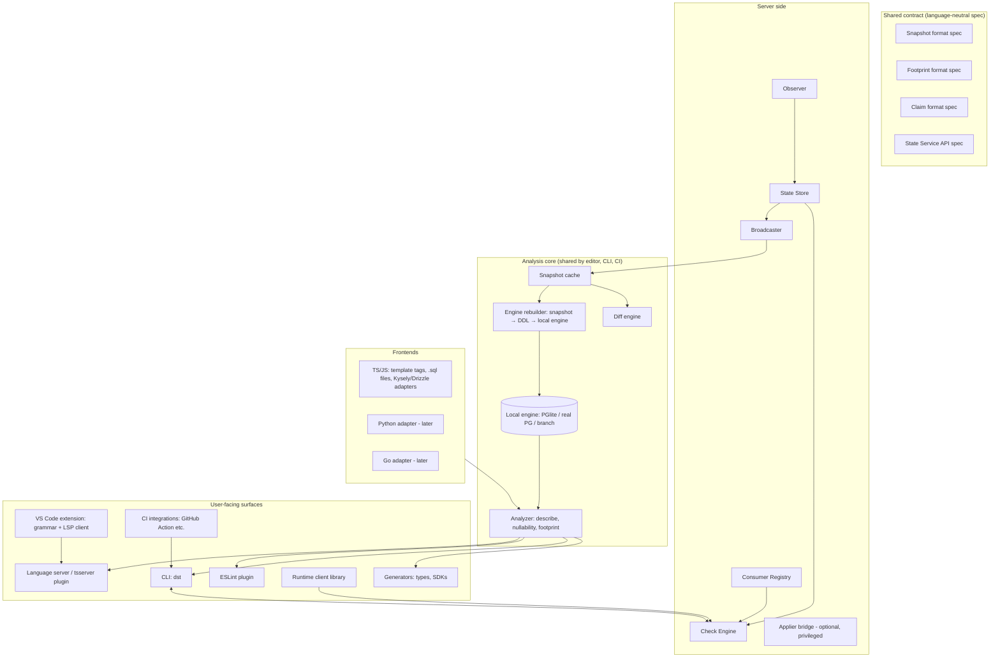
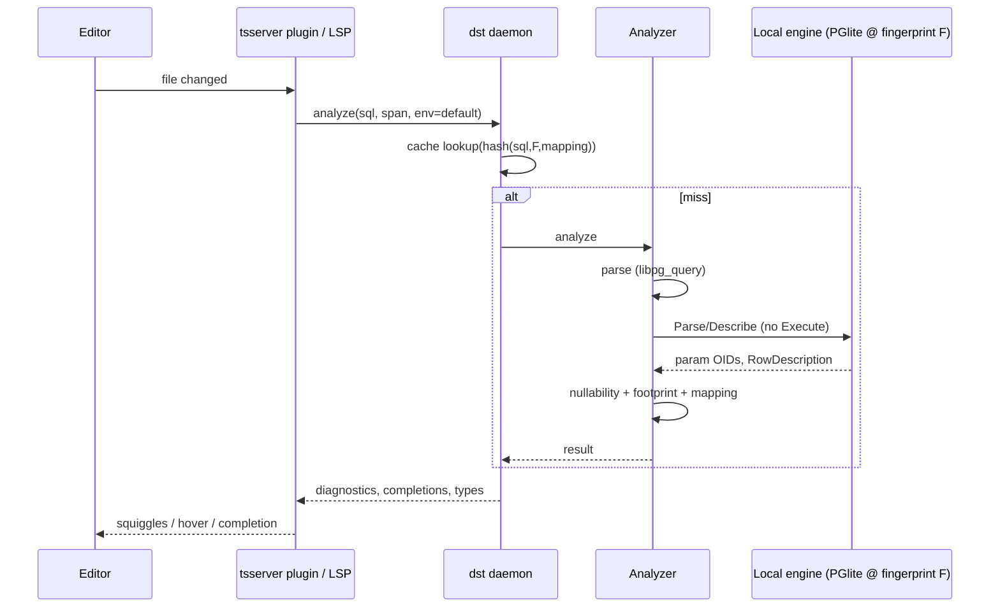

# 04 — Architecture

This document breaks the system into components, defines their responsibilities and interfaces, and describes the main data flows and deployment shapes. It's a *proposed* architecture to vet, not a settled one.

## 1. Component map



## 2. Components

### 2.1 Observer (server side)

**Job:** produce snapshots of each registered database environment.

- Connects with the **observer role** (catalog-read only; see [11](11-security.md)).
- Runs a **catalog extraction query set** per engine/version (for Postgres: `pg_catalog` queries, not `information_schema`, because `information_schema` filters out objects the role has no privileges on. ⚠ Verify per object type).
- Normalizes into the canonical snapshot form and computes fingerprints ([05](05-state-model-and-versioning.md)).
- **Change detection**, cheapest to most real-time:
  1. Polling: re-snapshot every N seconds and compare fingerprints. Simple, works everywhere, catalog queries are cheap.
  2. Event-driven: an **event trigger** on `ddl_command_end` / `sql_drop` that runs `pg_notify('dst_schema_changed', ...)`, with the Observer `LISTEN`ing. Lower latency but needs elevated privileges to install, and isn't available everywhere ([10](10-database-features.md)).
  3. Migration-tool hooks: the applier reports "I just applied X" so the snapshot can be attributed to a known transition.
- **Attribution:** when a new state appears, link it to a known transition if one was reported (a migration ID/hash), otherwise record it as an **unattributed transition** (drift).

### 2.2 State Store

**Job:** durable history of snapshots and lineage.

- Content-addressed blob store for snapshots (dedupes identical states across environments).
- Per-environment ref log: `(env, fingerprint, observed_at, transition_id?)`.
- Backends: Postgres (yes, store it in a database), SQLite, or object storage. For the serverless shape, **an OCI registry or S3 bucket** holding snapshot blobs plus a small index. 💡 OCI artifacts fit well: content addressing, auth, retention and mirroring already exist in most orgs.

### 2.3 Consumer Registry

**Job:** know which code depends on which state, per environment.

- A consumer (`billing-service@3f2a1c`) registers its **footprint** at build time (from CI) and its **deployment** at deploy time (env + version).
- Answers "who would break if state S changed to S'?" by checking each deployed consumer's footprint against S'.
- Optional runtime augmentation: the runtime client or `pg_stat_statements` can report queries actually executed, catching consumers that never registered (a script, a BI tool). See [10](10-database-features.md).

### 2.4 Check Engine

**Job:** answer compatibility questions.

- `check(footprint, state) → satisfied | violations[]`
- `impact(transition | state', env) → affected consumers + violations`
- `verify(claim, env) → fulfilled | pending | violated`
- Pure functions over snapshots and footprints. The same library runs inside the CLI for offline checks.

### 2.5 Broadcaster

**Job:** push new states to interested clients.

- Server-sent events / WebSocket stream per environment, or webhooks (Slack, CI re-trigger).
- Clients may also just poll `GET /envs/{env}/head`. Push is a latency improvement, not a requirement.

### 2.6 Applier bridge (optional, privileged)

**Job:** let `dst` apply change sets itself (owner mode), or wrap external migration tools so they report transitions.

- Deliberately separate from everything else, with separate credentials, separate network policy and CI-only access ([11](11-security.md)).
- A thin wrapper: `dst apply --via atlas|flyway|sqitch|psql|builtin`. It runs the tool, then reports the transition and triggers a fresh snapshot.

### 2.7 Snapshot cache & lockfile (client side)

- User-level cache: `~/.cache/dst/snapshots/<fingerprint>.json` (content-addressed, shared across projects).
- Project lockfile: `.dst/state.lock.json`, committed, pins `{ env: fingerprint }` for each target environment, plus the snapshot source and signature. Makes builds reproducible and offline-capable.
- Optional committed snapshots (`.dst/snapshots/*.json`) for fully hermetic CI without State Service access, similar to sqlx's offline `.sqlx/` metadata. ⚠ Snapshot confidentiality: see [11](11-security.md).

### 2.8 Engine rebuilder & local engine

**Job:** turn a snapshot back into a live engine that can *describe* queries.

- Snapshot → ordered DDL (dependency-sorted; extensions first, then types, tables, constraints, views, functions). Bodies of functions/views come from catalog-reconstructed definitions (`pg_get_viewdef`, `pg_get_functiondef`).
- Default engine: **PGlite** in-process (WASM Postgres). No Docker, no ports, starts in about a second (⚠ verify cold start), supports some extensions including pgvector (⚠ verify the current extension list).
- Fallbacks for fidelity: a local real Postgres of the **same major version** as the target (via a managed binary or Docker, opt-in), or a cloud **DB branch** (Neon/Supabase branching) for CI.
- Engine pool keyed by fingerprint: switching environments means switching engines, not rebuilding.
- **Fidelity gap:** PGlite tracks a specific Postgres major version and a subset of extensions. If the snapshot needs an extension PGlite lacks, the rebuilder must **stub** it (create types/functions with matching signatures so Describe still works) or escalate to a real engine. 💡 Stubbing from catalog signatures is a strong idea: Describe only needs signatures, not implementations.

### 2.9 Analyzer

**Job:** `(sql, params-hints, dialect, engine) → AnalysisResult`.

```ts
interface AnalysisResult {
  ok: boolean;
  diagnostics: Diagnostic[];          // syntax errors, unknown objects, type mismatches; with SQL-relative spans
  params: ParamInfo[];                // $1..$n: db type, ts type, nullable-allowed
  columns: ColumnInfo[];              // name, db type, ts type, nullable, source (table.col | expression)
  footprint: Requirement[];           // what this query relies on
  statementKind: "select" | "insert" | "update" | "delete" | "ddl" | "other";
  cacheKey: string;                   // hash(sql, engineFingerprint, mappingConfig)
}
```

Pipeline:

1. **Parse** with the engine's real parser (`libpg_query` for Postgres) → syntax diagnostics with exact positions, plus an AST for footprint extraction and nullability analysis.
2. **Describe** via the extended protocol (Parse/Describe, never Execute) on the local engine → parameter type OIDs, result column type OIDs, and source table OID / attribute number for each column.
3. **Nullability inference**: combine catalog `attnotnull`, AST analysis (outer joins, aggregates, `COALESCE`, `CASE`, literals) and optionally `EXPLAIN (VERBOSE)` plan output. Heuristic by nature; see [07](07-type-safety.md).
4. **Footprint extraction**: walk the AST plus resolved OIDs → requirements.
5. **Type mapping**: DB types → host-language types using the *runtime driver's* configured parsers.
6. Cache by `cacheKey`.

The analyzer is the hottest path (it runs on every keystroke in the editor), so latency budgets apply ([08](08-developer-experience.md) §2).

### 2.10 Frontends (syntax adapters)

Each adapter: *find SQL in source → produce `(sql, param bindings, source map)` → hand to analyzer → map diagnostics back to source spans → deliver types.*

| Adapter | Extraction | Type delivery |
|---------|-----------|---------------|
| TS tagged template `` sql`...` `` | TS AST: `TaggedTemplateExpression` with a known tag | Inline annotation (lint-autofixed) or generated declarations; see [07](07-type-safety.md) §5 |
| TS `.sql` files | File per query/named blocks (pgTyped/sqlc style) | Generated `.ts` modules |
| Kysely / Drizzle | Compile the builder to SQL (`.compile()` / `.toSQL()`) in a sandbox, *or* just generate their schema types from the snapshot | Their native typing, fed by `dst` |
| Prisma | Generate `schema.prisma` from the snapshot (`db pull` equivalent) and/or TypedSQL `.sql` files | Prisma's own |
| Python (later) | `ast`-based extraction of `sql("...")` calls; psycopg / asyncpg | `.pyi` stubs / TypedDicts |
| Go (later) | sqlc-style `.sql` files | Generated Go structs (or feed sqlc directly from the snapshot) |

### 2.11 Language server / editor surfaces

- **VS Code extension:** TextMate grammar *injection* for highlighting SQL in tagged templates / `sql(...)` calls, plus a client for the `dst` language server.
- **tsserver plugin:** diagnostics and completions inside TS files (editor only; `tsc` ignores plugins).
- **ESLint plugin:** the same diagnostics in CI and in editors without the extension, plus autofix for inline type annotations.
- **Standalone LSP** for `.sql` files and non-VS Code editors.
- All of them talk to one **`dst` daemon** per workspace over JSON-RPC, so engines and caches are shared and the editor's synchronous plugin APIs aren't blocked (see [07](07-type-safety.md) §5.4 for why that matters).

### 2.12 CLI

```
dst init                      # scaffold dst.config.ts, detect frontends
dst pull [--env prod]         # fetch & verify latest snapshot(s), update lockfile
dst status                    # envs, fingerprints, staleness, pending claims
dst check [--env prod]        # analyze all code; footprint vs target state(s) + claims
dst gen [types|sdk|kysely|prisma]   # run generators
dst diff <envA> <envB>        # structural diff between two states
dst claim add|list|verify     # manage claims
dst impact <changeset.sql> --env prod   # who breaks if this is applied?
dst register --env prod --version $SHA  # register consumer footprint/deployment (CI)
dst gate --env prod           # deploy gate: verify footprint vs actual state
dst snapshot --url $DB --out file   # serverless mode: produce a snapshot from a DB
dst apply --via <tool> ...    # owner mode; privileged
dst lint <migration.sql>      # migration safety lint
```

### 2.13 Runtime client library

- Thin wrapper over an existing driver (`postgres` / `pg` for Node).
- Registers type parsers that **match the type mapping used at analysis time**. Typing is only sound if the runtime decodes values the way the analyzer assumed (e.g. `int8 → bigint`).
- **Startup check** (optional, recommended): on connect, fetch a cheap catalog fingerprint for the app's footprint objects and compare with the embedded footprint. Policy: `fail | warn | off`.
- Optional **runtime validation** for escape-hatch queries (Standard Schema: Zod/Valibot/ArkType).
- Optional telemetry: report executed query fingerprints to the registry.

## 3. Key data flows

### 3.1 Editor keystroke → diagnostic



### 3.2 Schema change in another repo → my editor

1. Team B merges a migration and CI applies it to `staging`.
2. The Observer detects the change (event trigger or poll), snapshots, and attributes it to `teamB/migrations/0042@hash`.
3. The Broadcaster pushes `staging → new fingerprint`.
4. My daemon (if subscribed and online) downloads and verifies the snapshot, rebuilds the engine, re-analyzes the open files and updates squiggles. The lockfile isn't changed automatically; `dst status` shows "staging is ahead of your lockfile by 1 transition". 
5. `dst pull` updates the lockfile. That's a deliberate commit, so builds stay reproducible.

### 3.3 PR that adds a column and uses it

See [06 §5](06-claims-and-build-gates.md#5-worked-examples). In short: the footprint isn't satisfied by `prod` → the PR includes `migrations/0043_add_plan.sql` → the claim is auto-derived ("in-PR change set") → CI applies 0043 to a copy of the prod snapshot, re-checks (satisfied), *and* runs an impact check of 0043 against prod's registered consumers (no breakage) → merge → deploy pipeline applies 0043 → deploy gate confirms the prod state satisfies the footprint → rollout.

## 4. Deployment shapes

| Shape | Description | Good for |
|-------|-------------|----------|
| **Local-only** | No server. Snapshots come from local migration files (rebuilt into PGlite) or a one-off `dst snapshot`. | Solo devs, OSS projects, first contact |
| **Serverless / CI-published** | A scheduled or post-migration CI job runs `dst snapshot` per environment and pushes signed snapshots to an artifact store (S3, OCI, GitHub artifacts). Clients pull. No long-running service. | Small teams; orgs that won't run another service |
| **Sidecar service** | The State Service runs next to each database (k8s sidecar, ECS task, VM) with private network access; full push, registry and gates. | Orgs with a platform team |
| **Central service** | One State Service observing many databases over private networking. | Larger orgs with many DBs |
| **DB extension (speculative)** | A Postgres extension with a background worker that maintains snapshot tables and notifies. | Self-hosted PG only; managed providers generally don't allow custom extensions. ⚠ Low priority |

The user's original phrase was "served alongside your database, maybe it's a plugin". The **sidecar** is the portable reading of "alongside", and the **extension** is the literal "plugin" reading. Recommendation: design the API so all shapes are interchangeable, and build serverless first, then the sidecar.

## 5. Language/implementation choices (proposed)

| Piece | Candidate | Rationale |
|-------|-----------|-----------|
| Analyzer core + daemon | **TypeScript first** (Node/Bun), possibly Rust later | PGlite and libpg_query (`libpg-query` / `pgsql-parser` npm) are first-class in JS; fastest path to the TS DX. Rust would help polyglot embedding later. |
| State Service | Go or TypeScript | Long-running network service; Go is a good fit for a sidecar; TS allows code sharing with the check engine. |
| Contract specs | JSON Schema + versioned docs | Language-neutral; generators for each client language |
| Check engine | Pure library, portable (TS first; WASM-compile if Rust) | Must run identically in CLI, CI and server |

## 6. Interfaces (sketches)

State Service HTTP API (all metadata, no data):

```
GET  /v1/envs                                   → [{name, head, observed_at}]
GET  /v1/envs/{env}/head                        → {fingerprint, observed_at, transition}
GET  /v1/snapshots/{fingerprint}                → snapshot (signed)
GET  /v1/envs/{env}/lineage?since=<fp>          → transitions
GET  /v1/envs/{env}/stream                      → SSE of head changes
POST /v1/check        {footprint, env|fingerprint}           → result
POST /v1/impact       {changeset|target_fingerprint, env}    → affected consumers
POST /v1/consumers/{name}/builds   {version, footprint}       (CI)
POST /v1/consumers/{name}/deploys  {version, env}             (CD)
POST /v1/claims       {claim}                                  (CI)
GET  /v1/claims?env=&status=
POST /v1/transitions  {env, changeset_id, tool, actor}         (applier)
```
