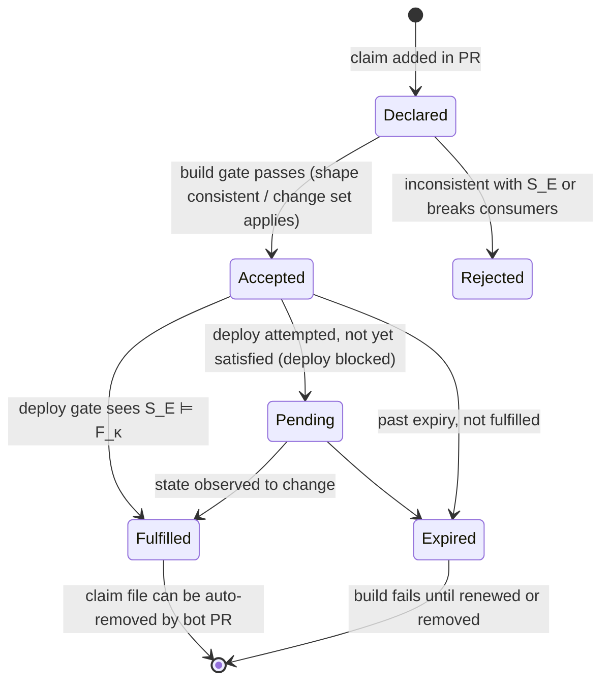

# 06 — Claims, Footprints & Build Gates

The user's original description:

> "...prevent your application from compiling/building without the user defining some sort of **authority** like declaring the related state in the same pull request and **claiming that it WILL run before the application code in question**, or the author is forced to make the database change some other way, whether that is manually, using the same or another tool, in a separate repo, language, who cares, the database state syncs periodically and is broadcast down to authors and the next build succeeds"

This is the most original part of the concept. This document makes it precise enough to implement and to find its edge cases.

## 1. Definitions

- **State** `S`: a snapshot (see [05](05-state-model-and-versioning.md)).
- **Requirement** `r`: an atomic predicate over a state, e.g.
  - `exists(table public.users)`
  - `column(public.users.email) ⊒ {type: text, notNull: true}` (the column exists, has type text, and is non-null, *because the code relies on non-null*)
  - `insertable(public.users, {email, status})` (all NOT NULL columns without defaults are covered)
  - `function(public.get_user_post_count, [uuid]) → int4`
- **Footprint** `F`: a set of requirements. `S ⊨ F` means "S satisfies every requirement in F".
- **Change set** `C`: a transition that maps a state to a new state, `C(S) = S'`. Identified by content hash. Can be a migration file, a declarative plan, or opaque (manual).
- **Environment** `E` with current state `S_E(t)`.
- **Claim** `κ = (E, F_κ, authority, expiry?)`: an assertion that before code needing `F_κ` is deployed to `E`, `S_E` will satisfy `F_κ`, through the given authority.

### 1.1 Precision of requirements

Requirements should record **exactly what the code relies on, no more**. That's what keeps unrelated changes from breaking things:

- `SELECT email FROM users` relies on `email` existing and on its type mapping. Nullability matters *only if* the generated TS type is non-null (it is, so it's included).
- `SELECT *` relies on the **entire column list and order** (it's a footprint over all columns). 💡 Lint: discourage `SELECT *` in application code because it widens the footprint.
- `INSERT INTO users (email) VALUES ($1)` relies on `email` accepting `text` *and* every other NOT NULL column having a default (otherwise inserts fail). That's a requirement over the *other* columns too.

## 2. The rules

### 2.1 Build gate (CI, and optionally local `dst check`)

For each target environment `E` (from config):

1. Compute the code's footprint `F`.
2. Take `S_E` = the latest known state of `E` (from the State Service, or the lockfile in hermetic mode).
3. Collect the claims `K_E` attached to this change (PR) targeting `E`.
4. Apply **verifiable** claims (those with a concrete change set): `S'_E = C_n(...C_1(S_E))`, applied in claim order on a local engine.
5. Remaining requirements `F_rem = F \ satisfied(S'_E)`.
6. Pass iff every `r ∈ F_rem` is covered by some **non-verifiable** claim (external/manual) in `K_E` whose `F_κ` includes `r`.
7. **Additionally** (impact check): for each verifiable change set `C` in `K_E`, check `C` against every **currently deployed consumer** of `E`: `C(S_E) ⊨ F_consumer`. A change that breaks a deployed consumer fails the build (or needs an explicit, approved "breaking" override). This is the expand/contract safety check; see [§4](#4-rolling-deploys-and-the-compatibility-window).

### 2.2 Deploy gate (CD, right before rollout to `E`)

1. Read the **actual** `S_E(now)` straight from the Observer (or take a fresh snapshot).
2. Require `S_E(now) ⊨ F`. **No claims accepted here.** Claims were promises, and this is where they must have come true.
3. If not satisfied: block the rollout, report which claims are unfulfilled and which requirements are missing.
4. If the pipeline itself applies the change sets (owner mode), the order is: apply `C`s → re-snapshot → gate → rollout.

### 2.3 Startup check (runtime)

1. The app embeds its footprint (or a compact digest: object fingerprints for the referenced objects).
2. On boot (and optionally on reconnect), fetch the current object fingerprints or shapes for those objects. That's one cheap catalog query.
3. Policy: `fail` (refuse to become ready, so the orchestrator holds the rollout), `warn`, or `off`.
4. This covers the window between the deploy gate and the actual start, plus out-of-band deploys that skipped the gate.

### 2.4 Editor

- Requirements unmet in the **primary** env (usually `local`) → error squiggle.
- Requirements met in `local` but unmet in a deployment target → **warning** "not yet in prod", with a quick fix: *"Add claim: in-PR migration `0044_add_plan.sql`"* or *"Add external claim"*.

## 3. Claim kinds

| Kind | Authority | Verified at build? | Verified at deploy? | Example |
|------|-----------|--------------------|--------------------|---------|
| **In-PR change set** | A change-set file in this PR | ✅ applied to a copy of `S_E` | ✅ actual state | `migrations/0044_add_plan.sql` |
| **Cross-repo change set** | Change set ID in another repo/pipeline, resolvable to content | ✅ if the content is fetchable | ✅ | `platform-db@a1b2c3:migrations/0099.sql` |
| **Shape claim** | "Some change will produce this shape" (no content) | Partial: the shape must be consistent with `S_E` (e.g. not conflict with existing columns) | ✅ | "`public.users.plan text NULL` will exist; DBA ticket OPS-123" |
| **Manual claim** | A person commits to doing it by hand | ❌ | ✅ | "I'll run this in the console after approval" |
| **Pending-transition claim** 💡 | Points at a transition the State Service already knows is *queued* for `E` (e.g. applied in staging, scheduled for prod) | ✅ via the lineage | ✅ | "Whatever staging got from teamB/0043" |

In-PR claims should be **auto-derived**: if the PR adds a change-set file that `dst` recognizes, the claim is implicit and nobody has to write anything. Explicit claim files are only for the cross-repo, shape and manual cases.

### 3.1 Claim file format (sketch)

```yaml
# .dst/claims/2026-10-24-plan-column.yaml
id: plan-column
environments: [staging, prod]
authority:
  kind: shape            # in-pr | cross-repo | shape | manual | pending-transition
  reference: "OPS-123"   # ticket, repo@sha:path, transition id...
provides:
  - column: public.users.plan
    type: text
    notNull: false
expires: 2026-11-15      # stale claims fail the build after this date
owner: "@caine"
```

### 3.2 Claim lifecycle



The State Service tracks claims centrally (`POST /v1/claims`) so it can report "3 claims pending against prod; oldest 9 days" and notify owners when their claim is fulfilled ("the next build succeeds", in the user's words).

## 4. Rolling deploys and the compatibility window

This is the part most likely to be underestimated. During a typical deploy:

```
time →
DB:     S0 ────────── C applied ──────────── S1 ────────────────────
code:   v1 running ─────────────── v1 + v2 both running ── v2 only ─
```

So:

- **`v1` (old code) must work against `S1`**. The change set must be *backward compatible* with deployed consumers. That's the impact check (§2.1 step 7).
- **`v2` must work against `S1`**. That's the deploy gate.
- If the migration runs *after* code rollout (some pipelines do), `v2` must also work against `S0`, i.e. `v2`'s footprint must be satisfied by **both** states. `dst` can check this: `S0 ⊨ F_v2 ∧ S1 ⊨ F_v2`.

This turns the usual expand/contract practice into checkable rules:

| Step | What `dst` checks |
|------|-------------------|
| **Expand** (add `plan` nullable) | `C_expand(S_prod) ⊨ F_consumer` for all deployed consumers ✅ |
| **Migrate code** (read/write `plan`) | `S_prod ⊨ F_v2` at the deploy gate |
| **Backfill** (data) | Out of scope for structure; could be a claim type later |
| **Contract** (make `plan` NOT NULL, drop `old_plan`) | `C_contract(S_prod) ⊨ F_consumer` for all *currently deployed* versions. Fails while any `v1` still references `old_plan` ✅ |

💡 Because the Consumer Registry knows **which versions are deployed where**, `dst` can say exactly when a contract step becomes safe: "`old_plan` is still referenced by `billing-service@v1.8` (deployed in prod, eu-west-1)".

Prior art: **pgroll** and **Reshape** solve the same window at the database level by serving multiple schema versions at once through views. `dst` could integrate with them (each schema version is a state; consumers bind to a version) instead of competing. ⚠ Evaluate.

## 5. Worked examples

### 5.1 Same-PR column add (the happy path)

1. Dev writes `` sql`SELECT id, plan FROM users` ``. Editor: error in `local` ("column plan does not exist").
2. Dev adds `migrations/0044_add_plan.sql`: `ALTER TABLE users ADD COLUMN plan text;`. The local env rebuilds and the error clears. A warning remains: *"prod lacks `users.plan`; covered by in-PR change set 0044 (auto-claim)"*.
3. CI build gate: apply 0044 to `S_prod` copy → `F` satisfied ✅. Impact: 0044 vs prod consumers → additive, no breakage ✅.
4. Merge. CD applies 0044 to prod → Observer snapshots → deploy gate `S_prod ⊨ F` ✅ → rollout.

### 5.2 Schema owned by another team

1. Dev needs `users.plan`; the schema is owned by `platform-db` repo (dev's project is an **observer**).
2. Dev adds a **cross-repo claim** pointing at the platform team's open PR (`platform-db#512:migrations/0099_add_plan.sql`). The build gate fetches it, applies it to a copy, passes ✅.
3. Dev's PR merges. The deploy to prod is **blocked** at the deploy gate (claim pending) until `platform-db#512` is applied to prod.
4. The State Service observes the change, marks the claim fulfilled, notifies the dev and re-triggers the blocked deploy (optional), and the deploy proceeds. *"The database state syncs periodically and is broadcast down to authors and the next build succeeds."*

### 5.3 Manual DBA change

Same as 5.2 with a `manual` or `shape` claim referencing a ticket. The deploy gate is the only real verification, and that's enough.

### 5.4 Someone drops a column by hand in prod

1. The Observer sees a new state; the transition is unattributed → **drift**.
2. The impact engine checks deployed consumers: `reporting-service@v3` references the dropped column → alert to its owners and the platform channel.
3. Those consumers' next builds fail against `prod` with a clear message ("`public.orders.legacy_ref` was dropped at 14:03 by an unattributed change").

### 5.5 Two PRs with conflicting claims

PR A claims `users.plan text`; PR B claims `users.plan int4`. Each passes alone. Mitigations:

- The State Service holds a **claim ledger** per env: a new claim is checked against *accepted, unfulfilled* claims for overlapping objects → B is rejected with "conflicts with accepted claim plan-column (PR A)".
- With a **merge queue**, run the build gate against `S_E + all queued change sets`.

## 6. Edge cases and open problems

| Case | Problem | Direction |
|------|---------|-----------|
| Claim becomes true, then false | Fulfilled, then someone drops it | The startup check and drift alerts cover it. Claims are point-in-time |
| Multi-region / sharded DBs | Many instances per env, applied at different times | Env = a set of instances; the deploy gate requires *all* (or the instances the rollout targets) to satisfy `F` |
| Per-tenant DBs (DB-per-customer) | Thousands of instances | Sample + aggregate; "fleet state" = distribution of fingerprints; gate on "≥ X% at fingerprint" or per-tenant routing |
| Feature-flagged code paths | Code needing `plan` only runs when a flag is on | 💡 Footprint annotations: `requires-when: flag(new_billing)`. The deploy gate allows missing requirements behind disabled flags; startup check is flag-aware. Complex, so later |
| Branch-based preview envs | `pr-1234` DB created from a prod snapshot + PR migrations | Natural fit: the env is created from `S_prod` + in-PR change sets |
| Long-running PRs | `S_prod` moves under them | The build gate always uses the latest `S_E`, so it re-runs on rebase; the lockfile diff shows the move |
| Down-migrations / rollbacks | Rolling back code after contract | The impact check should consider **rollback targets**: the previous code version must still be satisfiable if you might roll back |
| Claims in non-PR workflows (trunk-based, direct pushes) | No PR to attach to | Claims live in the commit; the gate works the same |

## 7. Why not just "run migrations before deploy" and be done?

Because that only works when **one pipeline owns both the migration and the code**. The claims model is for everything else: separate repos, separate teams, manual processes, multiple consumers. It also helps the single-pipeline case through the impact check (old code vs new schema), which most pipelines don't do today.
