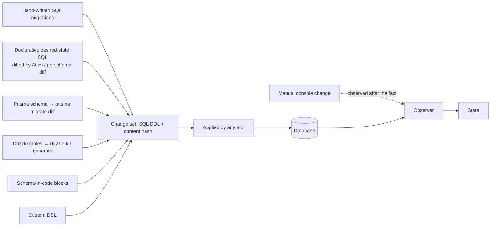

# 09 — Schema Authoring, Ownership & Migrations

Requirements: R6 (external ownership), R9 (syntax agnostic), R11 (any mechanism), R15 (migration integrity), R17 (know if operations are valid / already applied), R5 (dynamic).

## 1. Principle: authoring is a frontend too

Just as queries can be written in any syntax, **structural changes can be authored in any syntax**. Every authoring style ultimately produces a **change set**: SQL DDL in the target dialect. `dst` works with change sets and states. It doesn't care how they were authored.



## 2. Ownership modes

From the conversation: "apps can choose to own the database, or just assume those operations are owned elsewhere."

| Mode | Applies changes? | Source of `local` env | Claims needed for new state? |
|------|------------------|----------------------|-------------------------------|
| **Owner** | Yes (its pipeline applies its change sets) | Its own change sets | Auto (in-PR) |
| **Co-owner** | For the objects it owns (by schema or object pattern) | Pulled snapshot + its own change sets layered on top | Auto for owned objects; cross-repo/manual for others |
| **Observer** | Never | Pulled snapshot (or committed snapshot) | Always cross-repo/shape/manual |

Ownership can be **declared in the database** too 💡 (`COMMENT ON SCHEMA billing IS '@dst owner=billing-service'`, or a `dst_ownership` table). Then the State Service can reject an impact/apply from a non-owner, and `dst` can route review requests to the owners. CODEOWNERS for database objects.

## 3. Built-in migration support (optional)

`dst` should work with *any* migration tool. A minimal built-in runner is still useful for single-player mode and as a reference implementation.

### 3.1 File layout and ordering

```
db/migrations/
├── 20261024120000_init_users.sql
├── 20261024123000_add_vector_index.sql
└── 20261024141500_create_audit_trigger.sql
```

- **Ordering:** lexicographic by prefix (timestamp recommended over sequence numbers so parallel branches don't collide on `0043`).
- ⚠ Timestamps reduce collisions but allow **out-of-order merges** (branch A's older timestamp merges after branch B's newer one, so A's migration sorts *before* B's but was applied *after* it in some envs). Options: refuse out-of-order (Flyway's default behaviour, ⚠ verify), allow it with a warning, or use **dependency-based** ordering (below).
- 💡 **Dependency-based ordering (Sqitch-style):** each change declares `requires:` other changes. That fits the claims model better than linear order, because claims are already about "X must exist before Y". The built-in runner could support both: implicit linear order, plus optional explicit `-- requires: 20261024120000_init_users` headers.

### 3.2 Ledger and integrity

- History table `dst_migrations(id, checksum, applied_at, applied_by, duration_ms, tool)` in a dedicated schema (`dst`).
- **Checksum mismatch** for an applied migration → halt. (Allow an explicit `dst migrations repair` for whitespace/comment-only changes, as Flyway does. ⚠ verify Flyway's semantics.)
- **But the ledger isn't the source of truth.** The *state* is. If the ledger says 0042 is applied but the state doesn't match the expected `0042(S_prev)` result, `dst` reports **drift**. That's stronger than ledger-only tools, which trust the ledger.

### 3.3 "Is this operation valid / already applied?" (R17)

Because `dst` knows the current state, it can answer for any change set `C`:

- **Valid?** Apply `C` to a copy of `S_E` on the local engine. Errors mean invalid.
- **Already applied?** Compare `C(S_E)` with `S_E`. If they're equal, `C` is a no-op against this state (already applied, or equivalent changes were made some other way). 💡 That makes migrations from *different tools* safely composable: if the DBA already added the column by hand, the migration tool's version can be detected as redundant and marked applied (with a confirmation step).
- **Partially applied?** Diff `C(S_E)` vs `S_E` and show which parts are already present.

### 3.4 Squash / baseline

- `dst migrations squash --before 20260101` → generate `00000000000000_baseline.sql` from the **state** at that point (snapshot → DDL), not by concatenating files. Old migrations are archived; the ledger gets a baseline row; environments already past the baseline are unaffected.
- Verify the squash: `baseline(∅) == S_at_cutoff` (fingerprint equality). Fingerprints make squash correctness provable rather than hoped for.

### 3.5 Rollback / down migrations

❌ *Correction:* the conversation suggested the tool "can automatically compute and generate safe rollback scripts" from snapshots. For **structure**, a reverse diff `diff(S_after → S_before)` is computable. For **data**, it isn't: rolling back `DROP COLUMN` restores an empty column, and rolling back a type change may fail. Position:

- Generate **structural** reverse plans, clearly labelled with data-loss warnings.
- Encourage **roll-forward** plus expand/contract as the primary strategy.
- The impact check in [06](06-claims-and-build-gates.md) treats "can we roll the *code* back?" as a first-class question.

## 4. Migration safety linting

Run on every change set (`dst lint`, and in the build gate). Rules are informed by state (table sizes as optional hints) and by footprints (references).

❌ *Correction:* the conversation's example "adding a NOT NULL column to a massive table without a default (which would lock the table)" is inaccurate. In Postgres, adding a NOT NULL column **without** a default *fails* if the table has rows. Adding a column with a **constant (non-volatile) default** has been a fast metadata-only change since PG 11. The real hazards are below.

| Rule | Hazard |
|------|--------|
| `CREATE INDEX` without `CONCURRENTLY` on a large table | Blocks writes for the duration |
| `ALTER TABLE ... ADD COLUMN ... DEFAULT <volatile>` (e.g. `random()`, `clock_timestamp()`) | Full table rewrite |
| `ALTER COLUMN ... TYPE` (most changes) | Rewrite + `ACCESS EXCLUSIVE` lock |
| `ALTER COLUMN ... SET NOT NULL` | Full scan under lock (use a `CHECK ... NOT VALID` → `VALIDATE` → `SET NOT NULL` sequence) |
| `ADD CONSTRAINT ... FOREIGN KEY` without `NOT VALID` | Scans and locks both tables |
| `ADD COLUMN ... NOT NULL` without default | Fails on non-empty tables |
| Any DDL without `lock_timeout` set | A lock queue behind a long transaction blocks all traffic |
| `DROP` / `RENAME` of objects referenced by registered consumers | Breaks consumers (footprint-aware: **`dst`'s unique rule**) |
| Renaming a column at all | Prefer add + backfill + switch + drop |
| Adding an enum label inside a transaction (older PG) | Restrictions vary by version ⚠ |

Prior art to reuse or integrate: **Squawk** (Postgres migration linter), **strong_migrations** (Rails), and similar. ⚠ Prefer integrating Squawk's ruleset over rewriting it; `dst` adds the footprint-aware rules.

## 5. External tools as authoring frontends

The user's insight: *"it can always be exported as sql, say another team uses prisma, it outputs sql which can then be dumped in migration files."*

| Tool | How SQL is obtained | Integration |
|------|--------------------|-------------|
| Prisma | `prisma migrate diff --from-... --to-schema-datamodel ... --script`; `prisma/migrations/*/migration.sql` | Treat `prisma/migrations` as a change-set source; or ignore and just observe the DB |
| Drizzle | `drizzle-kit generate` → `drizzle/*.sql` | Same |
| Atlas | `atlas migrate diff` → versioned SQL; or declarative `atlas schema apply` | Change-set source; or `dst apply --via atlas` |
| Flyway / Liquibase | SQL migrations (Liquibase also XML/YAML → `updateSQL`) | Change-set source; read their history tables for attribution |
| Sqitch | `deploy/*.sql` with a plan file with dependencies | Natural fit with the dependency model |
| Rails / Django / Alembic | Generate SQL (`sqlmigrate`, `alembic upgrade --sql`) | Change-set source in polyglot orgs |
| Manual | Console | Observed as unattributed transitions; claims cover the gap |

In the full model, **`dst` doesn't need to read any of these files at all**: it observes the resulting state. Reading change-set files is only needed for (a) the `local` env, (b) verifying in-PR claims before they're applied, and (c) attribution.

## 6. Schema-from-code: what survives

The user floated (stage 16) deriving schema from the application's control flow (run typed `CREATE TABLE` at boot; nested code sees the tables) and then pushed back on it (stage 17): it means hand-copying DDL into JS and restructuring apps.

**Assessment:**

- **General control-flow-based schema inference is infeasible.** Whether code "runs after" boot DDL depends on dynamic dispatch, DI containers, module load order, async scheduling, separate processes... It's undecidable in general and brittle in practice.
- **Two narrow versions are feasible and useful:**
  1. **Module-level schema declarations** (no flow analysis): `export const users = defineTable(sql\`CREATE TABLE users (...)\`)` registered statically. The set of declarations *is* a declarative desired state, diffed against the target (like Atlas declarative mode). That's just another authoring frontend (§1). `mode: "apply"` (owner) or `mode: "assume"` (observer: declarations act as *claims/expectations* checked at the deploy gate and startup check). That's the user's "own it or assume it" switch, and it fits the claims model directly.
  2. **Block-local DDL overlay** for ephemeral objects: within one function/transaction, DDL followed by queries is analyzed sequentially ([05 §7](05-state-model-and-versioning.md#7-dynamic-and-ephemeral-state)).
- "Assume-existing" declarations are basically **claims written in code**. That's a nice unification: a claim file and an assumed `defineTable` are the same thing at the model level.

## 7. Runtime DDL (dynamic schema)

| Use case | Recommendation |
|----------|----------------|
| Temp tables/views for a computation | Block-local overlay; or CTEs (preferred when possible) |
| Per-tenant tables/schemas | Table families (pattern + template). The Observer verifies members conform; non-conforming members are drift |
| Runtime-created views for reporting | Family or escape hatch; register them as ephemeral so they don't count as drift |
| Materialized view refresh | Not structural; no special handling |
| User-defined fields | Model as `jsonb` + declared shape, or escape hatch with runtime validation |
| Self-migrating apps (run migrations on boot) | Owner mode; the deploy gate happens *inside* the app: apply → re-snapshot → verify footprint → become ready |

💡 **Ephemeral namespace convention:** objects in schemas matching a configured pattern (e.g. `scratch_*`) or with an `@dst ephemeral` comment are excluded from fingerprints and drift alerts.

## 8. Open questions

- Should `dst` ship a migration runner at all, or always delegate (Atlas/dbmate/etc.)? A built-in runner is easiest for solo users but expands scope. *Leaning: ship a minimal one; make delegation first-class.*
- Ordering model default: linear vs dependency-based.
- Out-of-order migration policy.
- Where ownership metadata lives (DB comments vs config vs State Service).
