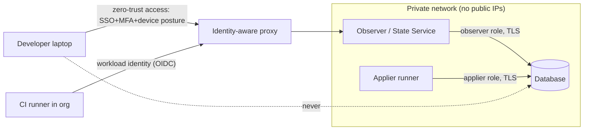

# 11 — Security

Requirements: R7 (developer machines never connect to cloud/prod DBs) and R16 (limited to employees, private networks and in-org CI/CD).

## 1. Security posture in one paragraph

`dst` handles **metadata, not data**. The State Service reads the catalog with a role that can't read table rows or change anything. Developers never receive database credentials; they receive **signed snapshots** of structure through an authenticated, private API. Every privileged operation (applying change sets) is isolated in a separate component that only CI/CD can use. The biggest residual risk isn't data exfiltration but **schema metadata disclosure** and **pipeline integrity** (forged snapshots, forged claims, bypassed gates).

## 2. Assets

| Asset | Sensitivity | Why |
|-------|-------------|-----|
| Database row data | Critical | Not handled by `dst` at all; must stay that way |
| DB credentials | Critical | Observer creds (low privilege) on the server; applier creds (high privilege) in CI only |
| Schema snapshots | **Confidential** | Reveal table/column names (e.g. `ssn`, `card_fingerprint`), function bodies (business logic, possibly embedded secrets in badly written functions), RLS policies (security model), privileges |
| Consumer registry | Internal | Reveals service topology |
| Claims / transitions | Internal, **integrity-critical** | Forged entries could bypass gates |
| Gate decisions | **Integrity-critical** | Bypass → broken deploys |

## 3. Threat model (STRIDE-ish)

| Threat | Example | Mitigation |
|--------|---------|------------|
| **Spoofing** a client | Attacker on the corp network queries the State Service | OIDC/SSO auth for humans, workload identity for CI, mTLS at the edge |
| **Spoofing** the server | Fake State Service feeds a developer a malicious snapshot | TLS + pinned internal CA; **snapshot signatures** verified client-side |
| **Tampering** with snapshots | Edited committed snapshot / lockfile makes CI pass against a fake state | Snapshots are signed by the Observer key; CI verifies signatures; *deploy gate re-reads the actual state anyway* (defense in depth) |
| **Tampering** with claims | Forged "fulfilled" claim | Claims are only ever *fulfilled by observation*, never by assertion; no API marks a claim fulfilled |
| **Repudiation** | "Who applied this change?" | Applier records actor (CI identity, PR, commit) with each transition; unattributed transitions are flagged as drift |
| **Information disclosure** | Snapshots leak sensitive schema details | Access control per database/env; optional redaction (function bodies, comments, privileges); avoid committing snapshots for sensitive DBs |
| **Information disclosure** via describe-as-a-service | Probing the existence of objects | Describe never runs on real DBs; only on local engines from snapshots the caller is already allowed to read |
| **DoS** on the database | Observer polling too often or heavy catalog queries | Rate limits, a dedicated connection with `statement_timeout`, event-driven detection where possible |
| **Elevation of privilege** | Observer compromised → attacker gets DB access | Observer role is catalog-only (§4); network policy limits the Observer to the DB port; no applier creds on the Observer host |
| **Elevation** via the event trigger | Malicious change to `dst.notify_ddl()` | Owned by an admin role; trivial body; included in the snapshot (so a change is itself observed as drift) |

## 4. Database roles: least privilege, done right

❌ *Correction:* the conversation's example was:

```sql
GRANT SELECT ON ALL TABLES IN SCHEMA public TO sidecar_observer;
REVOKE INSERT, UPDATE, DELETE, DROP ON ALL TABLES FROM sidecar_observer;
```

Two problems: (1) `GRANT SELECT ON ALL TABLES` **gives the observer access to all row data**, which contradicts the claim that a compromised sidecar couldn't "exfiltrate sensitive application user data". (2) `DROP` isn't a grantable privilege in Postgres. Dropping requires *ownership* (or superuser), so the `REVOKE ... DROP` line is invalid SQL.

Proposed roles:

```sql
-- Observer: reads catalogs only. No table privileges at all.
CREATE ROLE dst_observer LOGIN PASSWORD '…' NOSUPERUSER NOCREATEDB NOCREATEROLE NOINHERIT;
GRANT CONNECT ON DATABASE app TO dst_observer;
-- Catalog tables are readable by PUBLIC by default; nothing else needed for structure. ⚠ Verify
-- USAGE on schemas is not required to read pg_catalog rows describing them. ⚠ Verify
-- Optional, for consumer discovery (pg_stat_statements) and size hints:
-- GRANT pg_read_all_stats TO dst_observer;
ALTER ROLE dst_observer SET statement_timeout = '5s';
ALTER ROLE dst_observer SET default_transaction_read_only = on;

-- Notifier objects (event trigger + function) are owned by an admin role, created once at install.

-- Applier (owner-mode CI only): the migration role the org already uses. Not managed by dst.
```

Policy: **if a feature would require the observer to read row data, the feature is out of scope.**

## 5. Network and identity

Goal: only employees, private networks and in-org CI/CD.

### 5.1 Network placement



- The State Service has **no public endpoint**. Access is through an identity-aware proxy / zero-trust network (examples: Cloudflare Access/Tunnel, Tailscale, Google IAP, AWS Verified Access or Client VPN, Teleport, Pomerium). Org choice; `dst` just needs to work behind any of them (plain HTTPS + bearer tokens + optional mTLS).
- The Observer reaches the DB over private networking only.
- The **Applier** runs on CI runners inside the network (self-hosted runners, or cloud-hosted runners with private networking), never on the State Service host.

### 5.2 Authentication

| Principal | Mechanism |
|-----------|-----------|
| Developer (CLI/daemon) | OIDC device flow / browser login against the corporate IdP (Okta, Entra ID, Google Workspace) → short-lived access token + refresh token in the OS keychain |
| CI job | **Workload identity federation**: e.g. GitHub Actions OIDC token → exchanged for a short-lived `dst` token scoped to the repo/branch/environment. No long-lived secrets |
| Runtime app (startup check) | Doesn't need the State Service: checks against its *own* DB connection (it already has creds). Optional registry reporting uses workload identity |
| Service-to-service | mTLS with an internal CA (optional extra layer) |

### 5.3 Authorization (scopes)

| Scope | Developer | CI (PR) | CI (deploy) | Platform admin |
|-------|-----------|---------|-------------|----------------|
| `state:read` (snapshots, heads, lineage) | ✅ (per DB) | ✅ | ✅ | ✅ |
| `check` / `impact` | ✅ | ✅ | ✅ | ✅ |
| `claims:write` | ❌ (claims come from PRs via CI) | ✅ | ✅ | ✅ |
| `registry:write` (builds/deploys) | ❌ | ✅ builds | ✅ deploys | ✅ |
| `transitions:write` (report applied changes) | ❌ | ❌ | ✅ | ✅ |
| `apply` | ❌ | ❌ | ✅ protected envs require approval | ✅ |
| `admin` (envs, keys, policies) | ❌ | ❌ | ❌ | ✅ |

Per-database ACLs: a developer may read `main/*` but not `payments/*`. Redaction policy per DB (e.g. drop function bodies and comments for `payments`).

## 6. Snapshot integrity and confidentiality

- **Signing:** the Observer signs `sha256(canonical snapshot)` with an environment-scoped key (ed25519; key in a KMS/HSM). Clients verify against a trust bundle distributed via config (or a Sigstore-style transparency log, an option for later ⚠).
- **Lockfile** pins fingerprints, so a tampered snapshot file won't match.
- **Committed snapshots:** convenient for hermetic CI, but they put schema metadata in git (and in every clone, fork and CI cache). Policy options per DB: `allow`, `allow-redacted`, `deny`. Default: `deny` for prod snapshots unless the org opts in; CI fetches from the State Service instead.
- **Local cache:** `~/.cache/dst` stores snapshots; on shared machines use OS-level permissions; optional encryption at rest with a keychain-held key.

## 7. Gate integrity

- The **deploy gate must read the actual state** at deploy time (fresh observation), never trust a lockfile or a claim.
- Gate results are signed and recorded (env, consumer version, fingerprint, decision), so they can be audited.
- Branch protection: the `dst check` / `dst impact` status checks are required; overrides ("ship a breaking change anyway") need an approver with a specific role and are logged.
- The runtime startup check is the backstop if the gate is bypassed.

## 8. Privacy and compliance notes

- No personal data is processed (structure only), but schemas can reveal what personal data exists. Snapshot access should follow the same access reviews as source code for those systems.
- Audit log retention matches change-management requirements (SOX-style environments care about "who changed prod schema when"). The lineage + attribution model doubles as a **schema change audit trail**, a selling point for regulated orgs.
